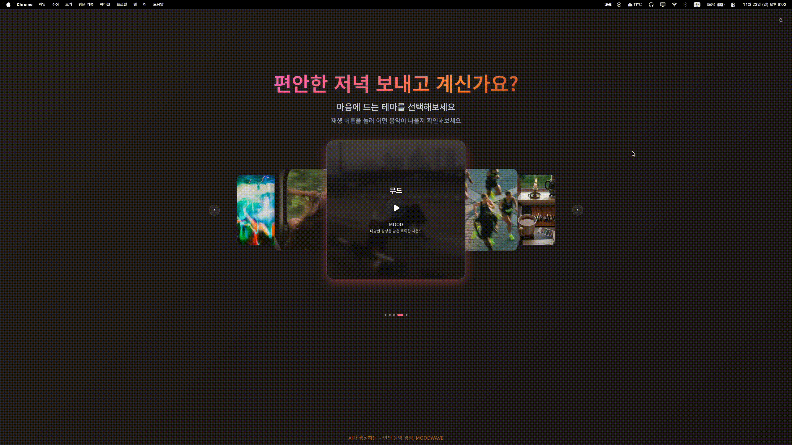
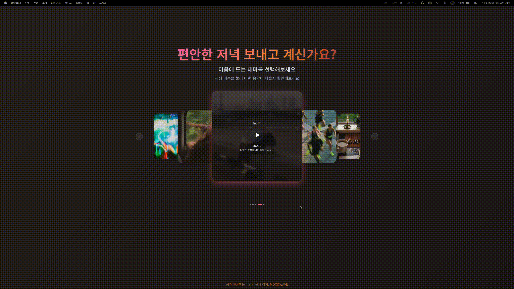
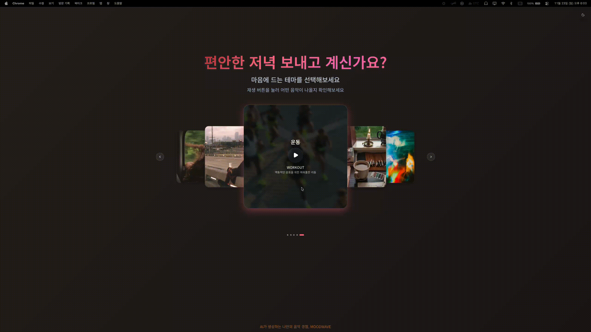
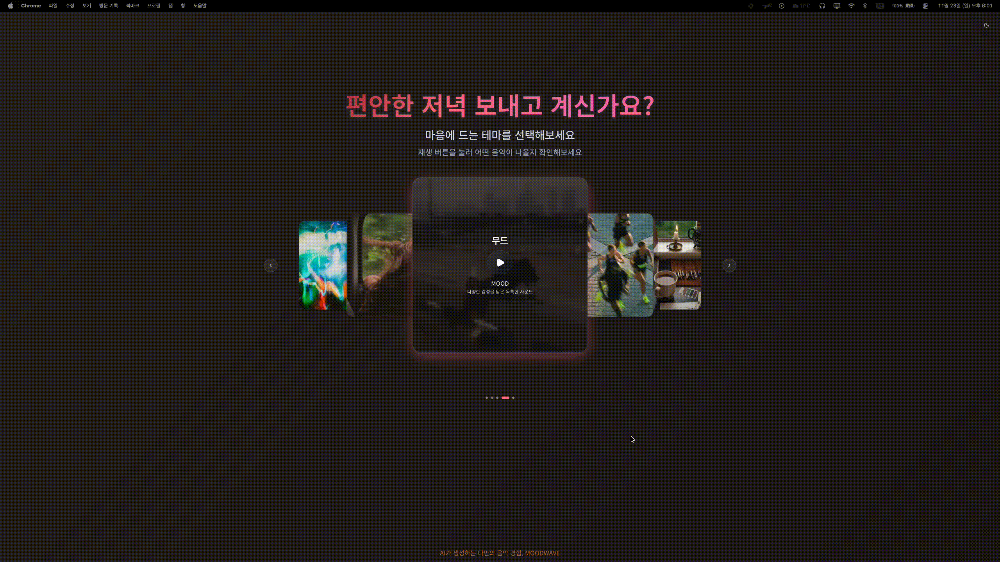
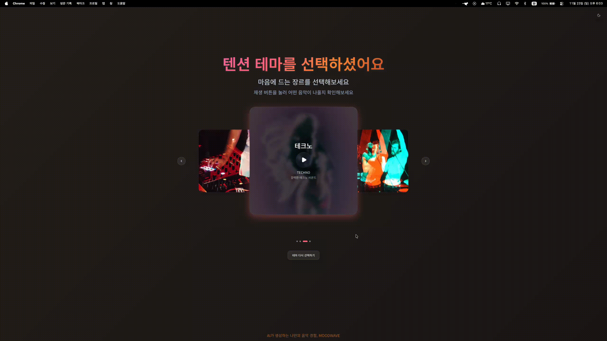
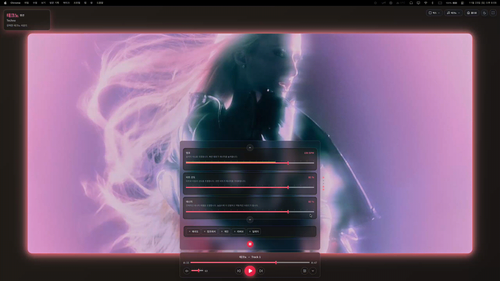
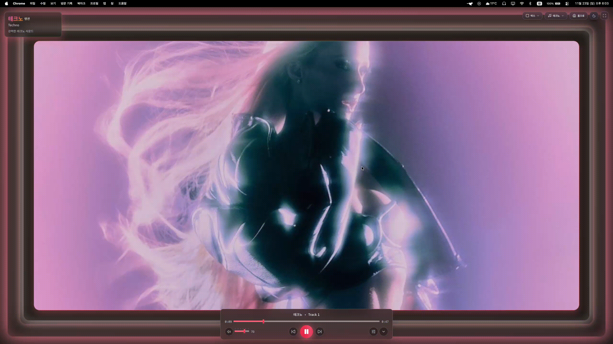
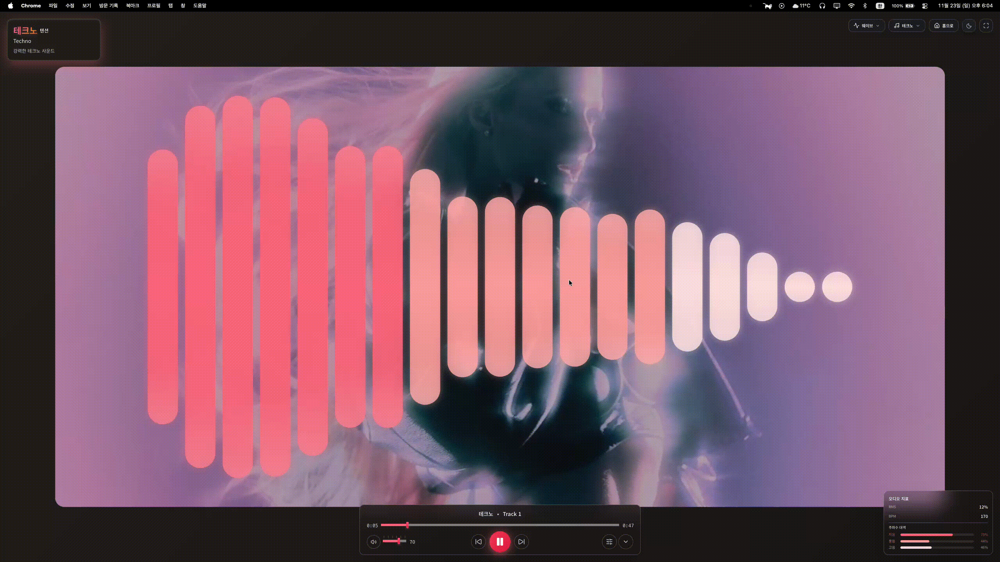
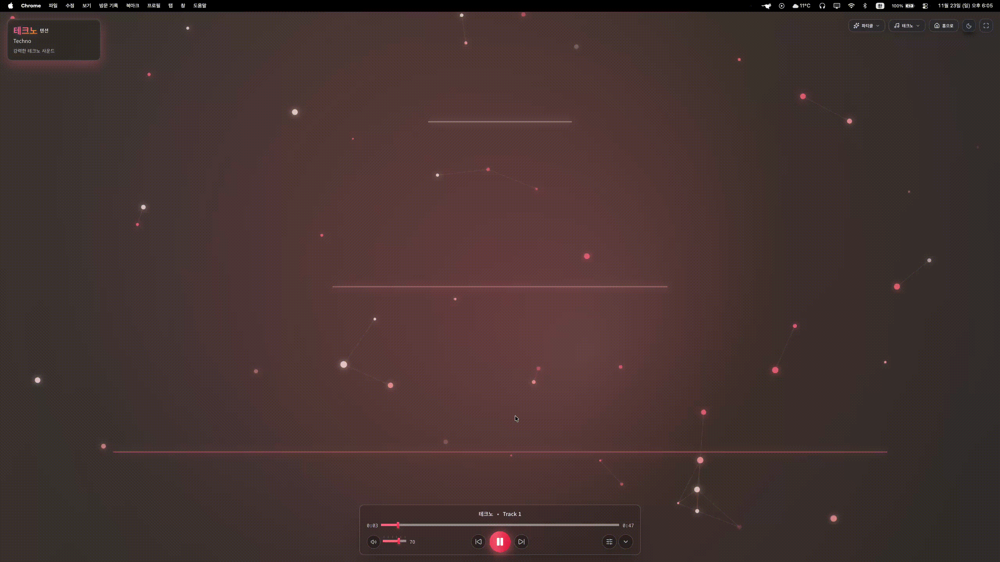
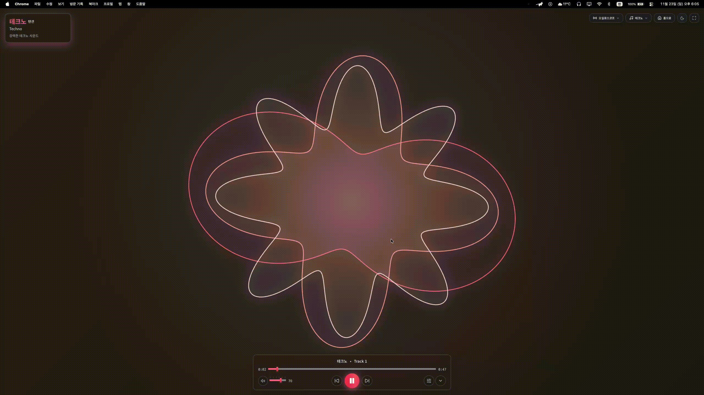

  
  <h1>MOODWAVE</h1>
  <h3>AI 기반 개인 맞춤형 음악 생성 및 스트리밍 서비스입니다.</h3>
  <h3>사용자의 감정과 상황에 맞는 음악을 실시간으로 생성하고 제공합니다.</h3>
  
<strong>2025 AI_conic 해커톤 S타입</strong>: 현대인의 스트레스 해소를 위한 서비스 출품작

  
  

    
    
  

### 팀원 소개

- 김진현(컴퓨터학부 글로벌SW융합전공 21): 프론트엔드 UI/UX 개발
- 신찬규(컴퓨터학부 심화컴퓨터공학전공 20): 음악 생성 AI 엔지니어링
- 홍지수(컴퓨터학부 심화컴퓨터공학전공 20): UI/UX디자인

### 시연 영상

  

**👉 [시연 영상 보러가기](https://www.youtube.com/watch?v=4nkp7TyQ6i0)**

### 서비스 개요

MOODWAVE는 사용자의 감정 상태와 활동 목적에 따라 AI가 음악을 실시간으로 생성하여 제공하는 개인 맞춤형 음악 스트리밍 서비스입니다.
사용자는 집중(Focus), 에너지(Energy), 휴식(Relax), 감정(Mood), 운동(Workout) 등 5가지 테마 중에서 선택할 수 있으며, 각 테마에는 3-4가지 세부 장르가 제공됩니다.
선택한 장르에 따라 AI가 음악을 생성하고, 사용자는 템포, 공간감, 명확도 등 다양한 오디오 파라미터를 실시간으로 조정하여 자신만의 완벽한 음악을 만들어낼 수 있습니다.

### 타서비스와의 차별점

1.  **AI 기반 실시간 음악 생성**: 기존 스트리밍 서비스와 달리, 사용자가 원하는 순간 바로 AI가 음악을 생성하여 제공합니다. 저장된 음악 라이브러리가 아닌 무한한 조합의 음악을 경험할 수 있습니다.

2.  **상황별 테마 기반 음악 추천**: 단순히 장르별 분류가 아닌, 사용자의 감정 상태와 활동 목적에 맞춘 5가지 테마(집중, 에너지, 휴식, 감정, 운동)를 제공하여 더욱 목적 지향적인 음악 경험을 제공합니다.

3.  **실시간 오디오 파라미터 조정**: 단순 재생이 아닌, 템포, 공간감, 명확도, 베이스, 리버브 등 다양한 오디오 파라미터를 실시간으로 조정하여 음악의 특성을 즉시 변경할 수 있습니다.

4.  **다양한 오디오 시각화 모드**: 음악에 맞춰 변화하는 4가지 시각화 모드(박스, 웨이브, 파티클, 오실로스코프)를 제공하여 몰입감 있는 시청각 경험을 제공합니다.

5.  **부드러운 전환 애니메이션**: Framer Motion을 활용한 고품질 애니메이션으로 사용자 경험을 향상시켰습니다.

### 주요 기능 가이드

1.  **랜딩 페이지**

랜딩 페이지에서 5가지 테마 중 하나를 선택하고, 원하는 장르를 찾을 수 있습니다.

- 테마별 카테고리 캐러셀을 통해 집중(Focus), 에너지(Energy), 휴식(Relax), 감정(Mood), 운동(Workout) 중 원하는 테마를 선택할 수 있습니다.
- 각 테마에서 3-4가지 세부 장르(총 19개 장르) 중 원하는 장르를 선택할 수 있습니다.
- 네비게이터와 인디케이터를 통해 현재 위치를 파악하고 쉽게 이동할 수 있습니다.
- 라이트 모드와 다크 모드를 전환할 수 있습니다.
- 선택한 테마나 장르의 샘플 음악을 플레이어로 이동하기 전에 미리 들어볼 수 있습니다.

2.  **AI 음악 생성 시스템**

선택한 장르와 설정한 파라미터를 기반으로 AI가 실시간으로 음악을 생성합니다.

- 음악 생성 API를 활용하여 선택한 장르에 맞는 음악을 실시간으로 생성할 수 있습니다.
- 장르와 사용자 설정 파라미터를 반영한 프롬프트로 개인 맞춤형 음악을 생성할 수 있습니다.
- 트랙 전환 시 부드러운 트랜지션 효과를 경험할 수 있습니다.
- 장르 변경 시 자동으로 새로운 음악을 생성하여 끊김 없는 재생을 할 수 있습니다.

3.  **플레이어 인터페이스**

플레이어에서 음악 재생을 제어하고, 파라미터를 조정하여 원하는 사운드를 만들 수 있습니다.

- 실시간 오디오 파라미터 조정 패널에서 템포, 공간감, 명확도 등을 조절할 수 있습니다.
- 테마별 기본 파라미터 3개와 추가 파라미터 7개를 선택적으로 사용할 수 있습니다
- 파라미터 값을 변경하면 AI를 통한 다음 곡 생성 시 반영됩니다.
- 파라미터 패널의 형태를 바꾸어 사용자 친화적으로 파라미터를 조정할 수 있습니다.

4.  **오디오 시각화**

음악에 맞춰 변화하는 다양한 시각화 효과를 선택하고 전환할 수 있습니다.

- 4가지 시각화 모드(박스, 웨이브, 파티클, 오실로스코프) 중 원하는 모드를 선택할 수 있습니다.
- 오디오 분석기를 통해 실시간 주파수 분석 결과를 시각적으로 확인할 수 있습니다.
- 음악의 비트와 주파수에 동기화된 시각 효과를 감상할 수 있습니다.
- 시각화 모드를 쉽게 전환하며 다양한 시각적 경험을 할 수 있습니다.

5.  **오디오 엔진**

음악 재생을 제어하고 조절할 수 있는 다양한 기능을 사용할 수 있습니다.

- HTML5 Audio API를 활용한 고품질 오디오 재생을 할 수 있습니다.
- 이전/다음 트랙 버튼으로 큐에 저장된 트랙을 탐색할 수 있습니다.
- 볼륨 조절 슬라이더와 음소거 버튼으로 음량을 조절할 수 있습니다.
- 재생/일시정지 버튼으로 음악 재생을 제어할 수 있습니다.

### 구현 내용 및 결과물

1.  **랜딩 페이지**
    - 테마별 카테고리 캐러셀을 통한 직관적인 음악 선택
    - 각 카테고리에 3-4가지 장르 제공 (총 19개 장르)
    - 반응형 디자인으로 다양한 데스크톱 화면 사이즈 지원
    - 다크 모드 지원

2.  **AI 음악 생성 시스템**
    - MusicGen API를 활용한 AI 기반 음악 생성
    - 장르와 사용자 설정 파라미터를 반영한 프롬프트 생성
    - 요청 큐 시스템을 통한 효율적인 API 호출 관리
    - 트랙별 자동 프리페칭을 통한 끊김 없는 재생

3.  **플레이어 인터페이스**
    - 실시간 오디오 파라미터 조정 패널 (템포, 공간감, 명확도 등)
    - 테마별 기본 파라미터와 추가 파라미터 시스템
    - 파라미터 값 변경 시 즉시 AI 음악 재생성
    - 확장 가능한 디테일 컨트롤 패널

4.  **오디오 시각화**
    - 4가지 시각화 모드 제공 (박스, 웨이브, 파티클, 오실로스코프)
    - 오디오 분석기를 통한 실시간 주파수 분석
    - 음악에 동기화된 시각 효과

5.  **오디오 엔진**
    - HTML5 Audio API를 활용한 오디오 재생
    - 큐 관리 시스템 (이전/다음 트랙 네비게이션)
    - 볼륨 조절 및 음소거 기능
    - 트랙 전환 시 부드러운 페이드 인/아웃

6.  **상태 관리**
    - Zustand를 활용한 전역 상태 관리
    - 플레이어 상태, 큐, 선택된 장르, 파라미터 값 등 관리
    - 테마별 다크/라이트 모드 설정

### 구현 방식

**프론트엔드**

- 언어: TypeScript
- 프레임워크: React 19.2.0
- 빌드 도구: Vite 7.2.2
- 스타일링: Tailwind CSS 4.1.17
- 상태 관리: Zustand 5.0.8
- 라우팅: React Router DOM 7.9.5
- 애니메이션: Framer Motion 12.23.24
- 오디오: HTML5 Audio API
- UI 컴포넌트: Lucide React

**API 및 서비스**

- MusicGen API: AI 음악 생성
- ElevenLabs API: 음성 합성 (추가 기능)
- FreeSound API: 샘플 사운드 제공

**배포**

- Vercel을 통한 프론트엔드 배포
- 환경 변수를 통한 API 키 관리

**개발 도구**

- ESLint: 코드 품질 관리
- Prettier: 코드 포맷팅

### 향후 개선 혹은 발전 방안

1.  **음악 생성 품질 향상**: 더 다양한 음악 스타일과 높은 품질의 AI 음악 생성을 위한 인프라 업그레이드 및 프롬프트 엔지니어링 개선
2.  **개인화 기능 강화**: 사용자의 음악 청취 패턴을 분석하여 개인 맞춤형 파라미터 프리셋 추천
3.  **소셜 기능 추가**: 생성한 음악을 공유하고 다른 사용자와 플레이리스트를 함께 만들 수 있는 기능
4.  **음악 저장 및 플레이리스트**: 좋아하는 음악을 저장하고 플레이리스트로 관리할 수 있는 기능
5.  **오프라인 모드**: 생성된 음악을 다운로드하여 오프라인에서도 재생할 수 있는 기능
6.  **향상된 시각화**: 더욱 다양하고 인터랙티브한 오디오 시각화 효과 추가
7.  **성능 최적화**: 큰 오디오 파일 스트리밍을 위한 최적화 및 캐싱 전략 개선
